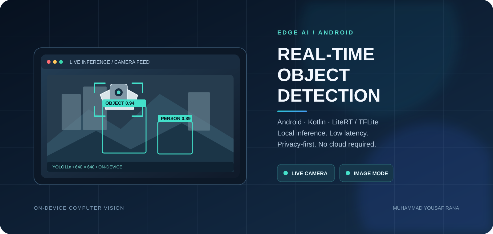

# Android-OnDevice-Object-Detection

  

An Android application demonstrating real-time on-device object detection using a locally bundled deep learning model (YOLO-style). The model runs inside the app (no network required), enabling offline inference, low latency, and improved privacy.

Repository: [Muhammadyousafrana/Android-OnDevice-Object-Detection](https://github.com/Muhammadyousafrana/Android-OnDevice-Object-Detection)  
Language: Kotlin  
License: MIT

---

## Table of contents

- [Features](#features)
- [What this project demonstrates](#what-this-project-demonstrates)
- [Architecture & key files](#architecture--key-files)
- [Model details](#model-details)
- [Requirements](#requirements)
- [Getting started](#getting-started)
  - [Clone & open](#clone--open)
  - [Build & run](#build--run)
- [Usage](#usage)
  - [Image mode](#image-mode)
  - [Camera mode (live)](#camera-mode-live)
- [How object detection works in this app](#how-object-detection-works-in-this-app)
- [Customizing or replacing the model](#customizing-or-replacing-the-model)
- [Performance tips & troubleshooting](#performance-tips--troubleshooting)
- [Testing](#testing)
- [Contributing](#contributing)
- [License](#license)
- [Acknowledgements](#acknowledgements)
- [Contact](#contact)

---

## Features

- On-device inference (no server required)
- Two modes:
  - Static image detection (pick an image from storage)
  - Live camera detection with overlayed bounding boxes
- Displays detected object labels, confidence, and bounding boxes
- Simple UI built with Jetpack Compose
- Model and inference wrapped by `ModelHelper` for preprocessing/postprocessing

---

## What this project demonstrates

- How to load and run a compiled TensorFlow/TFLite-like object detection model locally on Android.
- Preprocessing of camera/image frames to the model input size.
- Postprocessing of raw model output to extract bounding boxes, class IDs and confidences.
- Drawing bounding boxes and a Compose overlay for live detections.
- Basic optimizations for live processing (e.g., skipping frames, running inference on background threads).

---

## Architecture & key files

- `app/src/main/java/com/example/objectdetect/ModelHelper.kt`  
  - Responsible for loading the compiled model (uses `CompiledModel.create(...)`), creating input/output buffers, running inference and performing preprocessing/postprocessing. Contains constants such as:
    - MODEL_NAME: `yolo11n_float32.tflite`
    - INPUT_SIZE: `640`
    - NUM_CLASSES: `80`
    - Confidence and IOU thresholds used by postprocessing and NMS
  - Returns a list of Detection objects (bounding box, label, confidence, classId).
- `app/src/main/java/com/example/objectdetect/MainActivity.kt`  
  - Compose UI and screen definitions:
    - `ObjectDetectionScreen` with Image and Camera modes
    - Image picker flow and launching detection for selected images
    - Camera preview + frame analyzer that runs detection on selected frames (every Nth frame)
    - Canvas overlay to draw scaled bounding boxes for live camera feed
- `app/src/main/res/` — standard Android resources (themes, strings, layouts if any)
- `app/src/test` and `app/src/androidTest` — example tests / instrumented test.

---

## Model details

- Default model filename (as used in code): `yolo11n_float32.tflite` (loaded from app assets)
- Input image size used in the app: 640 x 640
- NUM_CLASSES used in code: 80 (COCO classes)
- The code does preprocessing that normalizes pixel values to [0,1] and expects a float32 input.
- Postprocessing:
  - The app decodes raw model outputs into bounding boxes and class confidences.
  - A confidence threshold is applied (default vs camera-specific thresholds).
  - Non-maximum suppression (NMS) / IOU thresholding is used to filter overlapping boxes.

Note: Verify the model's expected output layout (number of detections, channel ordering) before replacing it — the app's `postprocess` is implemented to match the bundled model's output layout.

---

## Requirements

- Android Studio (recommended: latest stable)
- Android SDK + emulator or a physical Android device with camera (for Camera mode)
- JDK (compatible version for the chosen Android Gradle Plugin)
- Gradle (use project Gradle wrapper)
- Ensure any native/runtime dependencies for the chosen model runtime are present. The code imports a runtime class `CompiledModel` (see `ModelHelper.kt`) — make sure the corresponding runtime dependency is available.

---

## Getting started

### Clone & open

1. Clone the repo:
   git clone https://github.com/Muhammadyousafrana/Android-OnDevice-Object-Detection.git

2. Open the project in Android Studio:
   - File → Open → select the cloned folder
   - Let Android Studio sync Gradle and download dependencies

### Build & run

1. Connect an Android device or start an emulator.
2. Build and Run the app from Android Studio (Run ▶).
3. Grant Camera permission when using Camera mode.

If Gradle fails due to missing runtime dependency for the model (e.g., litert or another inference runtime), add the appropriate dependency to `app/build.gradle` as required by your chosen runtime.

---

## Usage

### Image mode
- Tap "Image" mode.
- Select an image from your device.
- The app runs detection on the selected image and shows:
  - Processed image with bounding boxes (if not in live camera mode).
  - A list of detected objects with confidences.

### Camera mode (live)
- Tap "Camera".
- Grant camera permission when prompted.
- The app starts camera preview and runs detection on sampled frames (e.g., every 5th frame).
- Bounding boxes are drawn on a Compose Canvas overlay; a small list of detected objects and counts is shown at the bottom.

Implementation notes:
- For live camera processing, frames are analyzed on a background dispatcher (Dispatchers.Default).
- To reduce lag, the app only processes every Nth frame and recycles bitmaps when not processed.

---

## How object detection works in this app (high level)

1. Load compiled model from assets using `CompiledModel.create(context.assets, MODEL_NAME, Options(...))`.
2. For each image/frame:
   - Resize / scale to INPUT_SIZE x INPUT_SIZE.
   - Convert to float array and normalize pixels (R, G, B / /255f).
   - Write input into model input buffers and invoke `model.run(...)`.
3. Read raw output floats from model output buffers.
4. Postprocess:
   - Parse offsets and object confidences across predicted boxes.
   - For each detection, compute class-specific confidence and filter by threshold.
   - Apply NMS (IOU threshold) to remove duplicate overlapping boxes.
   - Map box coordinates back to the original image coordinates.
5. Return detections as a list of Detection objects and optionally draw them on the image or overlay canvas.

---

## Customizing or replacing the model

To replace the model:
1. Prepare/convert a model that is compatible with the inference runtime used by the project.
2. Ensure the model expects the same input shape / number of channels / data type or update `ModelHelper.kt` to match the new model’s preprocessing and output parsing.
3. Place the new model file in the app assets folder:
   - `app/src/main/assets/your_model.tflite`
4. Update `MODEL_NAME` constant in `ModelHelper.kt` to the new filename.
5. Update `NUM_CLASSES`, `INPUT_SIZE`, or postprocessing logic if the new model differs.
6. Rebuild and test thoroughly for correct detections and coordinate mapping.

Important: If your model's output layout differs (e.g., different anchors, grid sizes, output tensors shapes), you must update the `postprocess(...)` logic accordingly.

---

## Performance tips & troubleshooting

- If inference is slow:
  - Use a lighter/quantized model (e.g., uint8 or int8 quantized model) or a smaller architecture.
  - Use hardware acceleration if supported (update runtime options to use NNAPI, GPU, or other accelerators if supported by runtime).
  - Lower the input resolution (change `INPUT_SIZE`) but remember to adapt postprocessing.
- If you see incorrect boxes or label mismatches:
  - Confirm class label order and the number of classes match your model.
  - Verify the normalization and channel ordering (RGB vs BGR).
- Crashes loading the model:
  - Make sure the model file exists in `assets` and the filename matches `MODEL_NAME`.
  - Check that the required inference runtime dependency is included in Gradle.
- Camera permission issues:
  - Ensure runtime camera permission (android.permission.CAMERA) is requested and granted.

---

## Testing

- Unit test example: `app/src/test/java/com/example/objectdetect/ExampleUnitTest.kt`
- Instrumented test example: `app/src/androidTest/java/com/example/objectdetect/ExampleInstrumentedTest.kt`

For model correctness, prefer device testing (camera and CPU/GPU availability may differ between devices).

---

## Contributing

Contributions are welcome. Suggested contribution workflow:
1. Fork the repository.
2. Create a branch for your change: `git checkout -b feature/your-feature`.
3. Make changes and add tests where applicable.
4. Open a pull request describing the change.

Please ensure:
- Model-related changes include details about model format and expected output layout.
- Changes to detection/postprocessing are validated on sample images.

---

## License

This project is licensed under the MIT License — see the LICENSE file for details.

---

## Acknowledgements

- YOLO / object detection algorithm authors and contributors (for inspiration and model formats)
- Any model or runtime authors you choose to use (please attribute per their licenses)

---

## Contact

Maintainer: Muhammadyousafrana  
Project URL: https://github.com/Muhammadyousafrana/Android-OnDevice-Object-Detection
